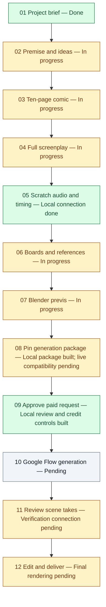

# AI Content Studio — project status board

Last updated: November 8, 2026.

**Purpose:** one reusable studio that researches promising ideas, uses the YouTube skills and the full AI Director Studio process to create videos for different channels, and helps us measure audience growth, costs and revenue.

**Current position:** the local foundation, film packages, credit controls, review screens and native temporary-dialogue connection are built. The complete idea → real Google Flow video → final delivery process is unfinished. Release 1 ends with a finished local video and upload materials; you upload manually.

## How to read and update this board

| Status | Meaning |
| --- | --- |
| Done | The specific item in that row is implemented and verified within its stated scope. |
| In progress | Some supporting functionality exists; the remaining work is listed. This does not mean an agent is currently running. |
| Pending | The required connection or functionality is not built yet. |
| Waiting for input | The next dependent action needs a tool choice, real input, access or approval. |

After meaningful work, update the affected row, date and next action here, then update [WORK_LOG.md](WORK_LOG.md) and the detailed [remaining build plan](REMAINING_BUILD_PLAN.md). Mark an item Done only with evidence. Keep unfinished parts separate rather than marking an entire workflow complete because its supporting tools work.

## Build checklist

| ID | What we are building | Status | What is done / what remains |
| --- | --- | --- | --- |
| B01 | Combine Director Studio and YouTube skills | Done | Both sources, skill files, supporting tools and licenses are together. |
| B02 | Preserve the Director Studio SOP | Done | All twelve obligations are mapped; Google Flow is the selected generation provider. This is workflow structure, not a finished video. |
| B03 | Short/long project brief | Done | Topic, audience, style, format and duration are validated and saved. |
| B04 | Combined skill selection and handoff | Done | All eleven YouTube skills are considered, with applicable/deferred reasons and current/historical output evidence. |
| B05 | Six executable YouTube helper tools | Done | Hook, title, edit, chapter, retention and outlier-analysis tools run and save verifiable receipts. |
| B06 | Shared dashboard / HTTP / CLI / MCP | Done | Implemented features share service rules; 28 agent operations, with no agent approval operation. |
| B07 | Trend discovery and original premise creation | In progress | Research analysis helper exists; connect public-source discovery and idea outputs to production. Continuous monitoring is later scope. |
| B08 | Real ten-page comic creation | In progress | Stage, import and review framework exist; actual image/page creation connection remains. |
| B09 | Full screenplay and shot packages | In progress | Script skill/helper and review stage exist; connect actual approved-comic adaptation and timed shot planning. |
| B10 | Temporary dialogue, measured audio, tracks and cues | Done | Explicit installed-voice selection, real native Mac speech or supplied agent recordings, measured mix/stems/SRT/cues, guarded source/revision checks and human review are connected and tested. Mac native execution verified; Windows boundary tests mocked. |
| B10a | Final production voice, music and sound mix | Waiting for input | Final voice/style and other audio assets still need selection and approval. QA speech is not the pilot's approved final narration. |
| B11 | Storyboards and clean references | In progress | Versioned import, source pins and review exist; connect actual boards/reference creation. |
| B12 | Blender previs | In progress | Editable-file/preview import and review exist; real Blender creation/execution remains. |
| B13 | Immutable film generation packages | Done | Exact prompts, ordered approved references, settings, source/file hashes and capability observations are saved. Observations do not establish live browser access. |
| B14 | Local credit and recovery controls | Done | Separate human package/spend decisions, cumulative caps, atomic reservations and unknown-result accounting are tested. No paid request is sent. |
| B15 | Package/spend review screens and audit exports | Done | Review exact inputs, cap/allowance/history, refresh saved state, and export film records without lease secrets. |
| B16 | Live Flow capability inspection | Waiting for input | Need supported browser access and direct user sign-in; verify actual account/model/input/duration/output/cost support. |
| B17 | Guarded Google Flow film generation | Pending | Connect the visible browser to the approved package/reservation, single submission, observation and recovery. |
| B18 | Original video download and verification | Pending | Retrieve actual takes, verify complete decodable files, retain original bytes/hashes and correlate provider evidence. A reported download is not a verified file. |
| B19 | Real take-review connection | In progress | Artifact review exists; connect verified originals, generation receipts and scene continuity review. |
| B20 | Final film rendering | In progress | Rough-cut timeline/review/export exist; render the complete MP4 with approved takes, audio, captions and credits. |
| B21 | Manual-upload delivery bundle | In progress | Writing skills exist; connect title/thumbnail, description, eligible chapters/Shorts and archive to the finished video. |
| B22 | Local regression and independent code review | Done | November8: 178 tests, build, four browser checks and independent reviews passed, including actual local speech. Recheck when relevant code changes. |
| B23 | Real twelve-step pilot acceptance | Waiting for input | Depends on production tools/assets, live browser/execution, approved creative versions, exact spending allowance and final playback. |
| B24 | Proposed third repository | Waiting for input | Need its URL and capability review before deciding integration. Nothing downloaded or integrated. |

## Twelve-step production chart

This is the required route. It shows software readiness, not approval of real pilot artifacts. Every creative/spending gate remains human-owned.

Golden rule: preserve all twelve obligations, exact-version approvals, source pins, leased handoffs, prior versions and stale-work invalidation. No silent approvals, provider substitutions or paid retries. Use relevant YouTube skills with actual saved outputs consumed downstream.

## After Release 1

| What we want later | Status | Work required |
| --- | --- | --- |
| Separate channel profiles | Pending | Save each channel's niche, audience, language, voice, style and formats; isolate assets/context. |
| Multiple YouTube / TikTok / Instagram accounts | Pending | Authorized account connections and explicit destination isolation. |
| Automatic upload and scheduling | Pending | Platform adapters, permissions, reviewed publishing decisions, duplicate prevention and receipts. |
| Continuous trend monitoring and notifications | Pending | Recurring research jobs and saved opportunity updates. |
| Comments, retention and channel-audit feedback | Pending | Skills exist; connect actual channel data and feed results into future production. |
| Business performance tracking | Pending | Measure production cost/time, reach, conversions and attributable revenue. |
| Unattended operation | Pending | Worker, scheduling, monitoring and interruption recovery after the active-session flow is proven. |

## Pilot and inputs still needed

**Selected:** a 24-second illustrated Short about a robot learning to garden, in English. This is one test project and does not restrict future channels or niches.

| Input | Status |
| --- | --- |
| Topic, Short format, 24-second duration, illustrated style, English | Done — user selected |
| Audience, voice direction and quality expectations | Waiting for input |
| Image/page, voice/audio and Blender tools or supplied assets | Waiting for input |
| Supported signed-in Flow browser and actual capability observations | Waiting for input |
| Exact creative artifacts, upload permission and credit/attempt allowance | Waiting for input — approve concrete versions/settings before generation |
| Final delivery specifications/location | Waiting for input |

Never store passwords, login codes, cookies or lease tokens in this board. Viral reach and income are objectives to measure, not guaranteed outcomes.

## What we do next

1. Resolve the pilot's remaining audience/final-voice inputs; select/connect image/page and Blender tools. Temporary dialogue already works; do not rebuild it.
2. Produce and review the actual premise, comic, screenplay, audio, boards and Blender outputs, using relevant skills.
3. Verify live Flow/browser compatibility early, then connect guarded generation and original downloads.
4. Complete final rendering and the manual-upload bundle.
5. Run and record SDET acceptance of the real video through every required obligation.

Development process: BA requirements → PO acceptance criteria → Developer implementation → SDET verification. Work stays on a local feature branch; the user reviews, commits, creates the PR and merges unless explicitly authorizing a specific action later.

Evidence: [combined validation](docs/COMBINED_VALIDATION.md), [local review](docs/sdlc/05-LOCAL-REVIEW.md), [Flow film contracts](docs/FLOW_FILM_WORKFLOW.md). Detailed tickets and technical dependencies remain in [REMAINING_BUILD_PLAN.md](REMAINING_BUILD_PLAN.md).

Editor maintenance, November 6: Python workspace defaults now point at the verified project `.venv` containing FastAPI/TestClient. If VS Code cached another interpreter, use **Python: Select Interpreter** and choose the project `.venv`. This is an editor configuration fix; it does not change production automation status.
